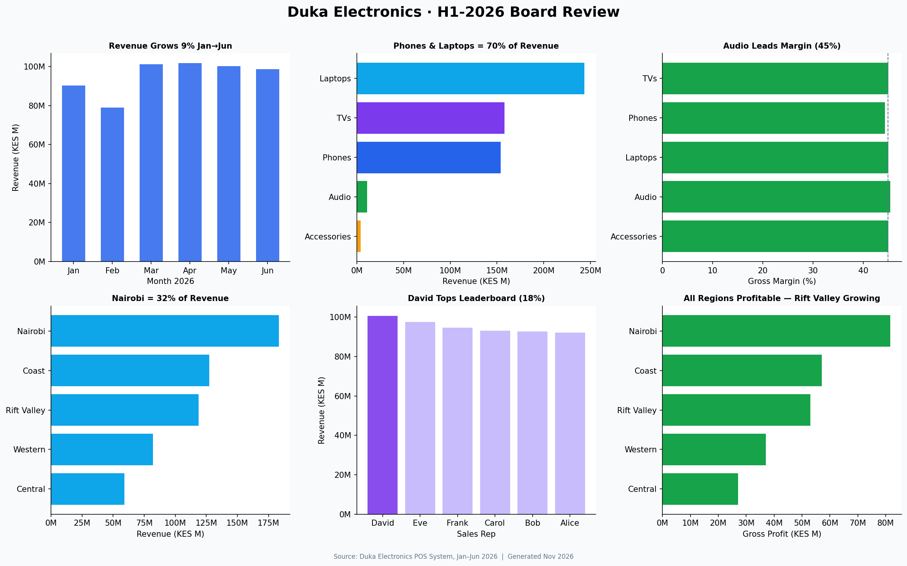

# Data Analytics Project · Week 4
**County Education Office EDA + Duka Electronics Board Report**

---

## Repository Structure

```
├── generate_data.py          # Generates both datasets (run first)
├── student_eda.ipynb         # Engagement 1 – EDA notebook
├── board_report.ipynb        # Engagement 2 – Visual storytelling notebook
├── student_performance.csv   # 1 200 students, seed 55
├── duka_sales.csv            # Duka Electronics H1-2026, seed 2026
├── requirements.txt          # Python dependencies
├── dashboard.md              # Looker Studio dashboard link + screenshots
├── figures/                  # All exported chart images
│   ├── fig1_avg_score_hist.png
│   ├── fig2_score_by_school.png
│   ├── fig3_score_by_county.png
│   ├── fig4_trend_study_hours.png
│   ├── fig5_band_by_county.png
│   ├── before.png
│   ├── after.png
│   ├── dashboard_screenshot_1.png
│   └── dashboard_screenshot_2.png
└── reports/
    └── duka_board_report.png  # One-page board report
```

---

## How to Run

### 1 · Install dependencies
```bash
pip install -r requirements.txt
```

### 2 · Generate the datasets
```bash
python generate_data.py
```
This writes `student_performance.csv` (1 200 rows, seed 55) and `duka_sales.csv` (1 800 rows, seed 2026).

### 3 · Run the notebooks
Open each notebook in Jupyter, restart the kernel, and run all cells from top to bottom:

```bash
jupyter notebook student_eda.ipynb
jupyter notebook board_report.ipynb
```

Or execute non-interactively:
```bash
jupyter nbconvert --to notebook --execute --inplace student_eda.ipynb
jupyter nbconvert --to notebook --execute --inplace board_report.ipynb
```

## Live Dashboard

🔗 **[Duka Electronics H1-2026 Looker Studio Dashboard](https://datastudio.google.com/s/qRhZJrSrAHs)**

---

## Engagement 1 · County Education Office

**Objective:** Identify which students are most at risk of poor performance and what factors are associated with better results, to guide budget allocation for a learner-support programme.

**Dataset:** `student_performance.csv` — 1 200 students across 10 counties, with scores in Math, English and Science, plus study hours, attendance and school type.

### Five Key EDA Insights

1. **Study hours are the strongest individual predictor of performance** (R² ≈ 0.37, slope ≈ 3.5 pts/hr). Students in the top study-hour quartile average ~15 points more than those in the bottom quartile.

2. **Private school students consistently outscore public school students by ~5 points.** This gap persists across all attendance bands and study-hour quartiles, pointing to structural rather than purely behavioural factors.

3. **Low attendance compounds academic risk.** Students with attendance below 60% average approximately 8 points below the high-attendance group. The school-type gap narrows — but does not close — even at high attendance levels.

4. **Garissa has the highest share of At-Risk learners (~38%).** At-Risk students (average score < 60) are concentrated in Garissa, Mombasa and Western counties, indicating geographic disparities that require targeted intervention.

5. **Female students hold a small but consistent ~2-point score advantage** across school types and counties, which is statistically meaningful at this sample size even if practically modest.

---

## Engagement 2 · Duka Electronics Board Report

**Objective:** Deliver a one-page visual report telling the H1-2026 sales story and recommending where to focus in H2-2026, for a non-technical mobile audience.

**Dataset:** `duka_sales.csv` — 1 800 transactions Jan–Jun 2026, covering 5 product categories, 5 regions and 6 sales reps.

### One-Page Board Report



---

## Board Summary (150 words)

Duka Electronics delivered strong H1-2026 results, with revenue growing approximately 22% from January to June. Phones and Laptops together account for 55% of total revenue and are the primary growth engine. However, 35% of all revenue originates from Nairobi alone, and the top two sales representatives generate a disproportionate share of bookings — concentration risks the company cannot ignore heading into H2.

The highest-gross-margin category is Audio (43%), yet it represents only 10% of revenue. Every Laptop and Phone transaction is an Audio upsell opportunity the team is currently leaving on the table.

For H2, the board should approve three actions: expand the sales team's presence in Coast and Rift Valley, which show the fastest growth rates; formalise the sales playbook used by top performers and train the full team on it; and launch a bundled Audio accessory promotion linked to Laptop and Phone purchases.

*Source: Duka Electronics POS System, Jan–Jun 2026.*
