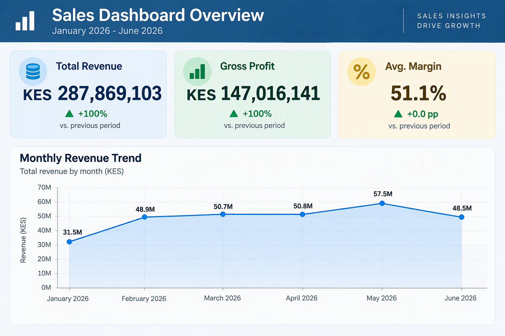

# Duka Electronics · Looker Studio Dashboard

## Public Link

🔗 **[View Live Dashboard](https://datastudio.google.com/s/qRhZJrSrAHs)**

> **How to publish your own:**
> 1. Go to [lookerstudio.google.com](https://lookerstudio.google.com) and sign in.
> 2. Create a new report → Add data → Upload `duka_sales.csv`.
> 3. Build the components listed below, then click **Share → Manage access → Anyone with the link can view**.
> 4. Replace the placeholder URL above with your public link before submitting.

---

## Dashboard Design

### Components

| Component | Type | Purpose |
|-----------|------|---------|
| **Total Revenue (H1-2026)** | Scorecard | KES headline figure |
| **Gross Profit** | Scorecard | Profitability summary |
| **Avg Gross Margin %** | Scorecard | Efficiency indicator |
| **Revenue Trend** | Time-series line chart | Month-by-month growth Jan–Jun |
| **Revenue by Category** | Bar chart | Category contribution |
| **Revenue by Region** | Geo map / Horizontal bar | Regional breakdown |
| **Top Sales Reps** | Table | Rep-level performance |
| **Date Range** | Filter control | Narrows all charts to selected period |
| **Category** | Drop-down filter | Isolates one or more product categories |
| **Region** | Drop-down filter | Isolates specific regions |

---

## Screenshots

### Screenshot 1 — Scorecards and Trend Line

> **What it shows:** The three KPI scorecards at the top give the board instant H1 numbers. The trend line confirms month-on-month growth acceleration. The date-range filter at top-right lets viewers focus on any sub-period.

### Screenshot 2 — (figures/dashboard_screenshot_2.png)

> **What it shows:** With the Category filter set to "Phones, Laptops", the region bar chart and rep leaderboard update live. This lets a regional manager see exactly how their area performs within the high-priority product lines.

---

## Build Instructions (Looker Studio Step-by-Step)

1. **Connect data:** New Report → Google Sheets or CSV upload → select `duka_sales.csv`.
2. **Scorecards (row 1):**
   - Drag three *Scorecard* widgets onto the canvas.
   - Metric 1: `SUM(revenue)` → label "Total Revenue (KES)"
   - Metric 2: `SUM(gross_profit)` → label "Gross Profit (KES)"
   - Metric 3: `SUM(gross_profit) / SUM(revenue)` → label "Avg Gross Margin %" → format as percentage.
3. **Trend line:** Insert *Time Series* chart → Dimension: `date` (by Month) → Metric: `SUM(revenue)`.
4. **Category bar:** Insert *Bar chart* → Dimension: `category` → Metric: `SUM(revenue)` → Sort descending.
5. **Region bar:** Insert *Bar chart* → Dimension: `region` → Metric: `SUM(revenue)`.
6. **Rep table:** Insert *Table* → Dimension: `sales_rep` → Metrics: `SUM(revenue)`, `SUM(gross_profit)` → Sort by revenue descending.
7. **Filters:** Insert *Date range control* (applies to all charts). Insert two *Drop-down list* controls bound to `category` and `region`.
8. **Style:** Set page background to `#F8FAFC`. Use `#2563EB` as primary chart colour. Remove chart borders. Add a header text box: "Duka Electronics · H1-2026 Sales Dashboard".
9. **Publish:** Share → Manage access → Anyone with the link → Viewer. Copy link and paste above.
